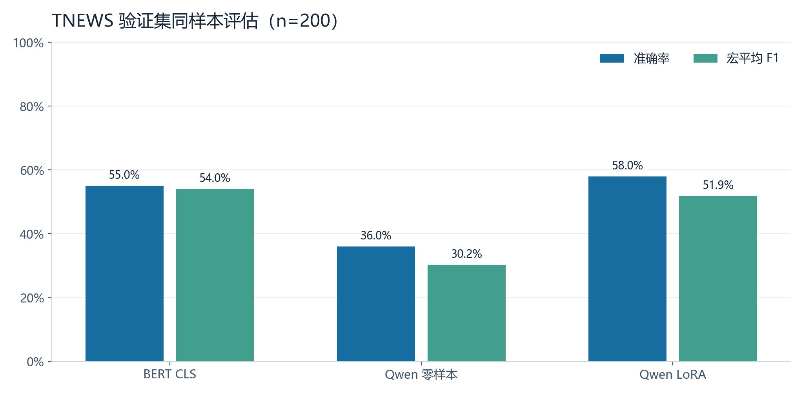
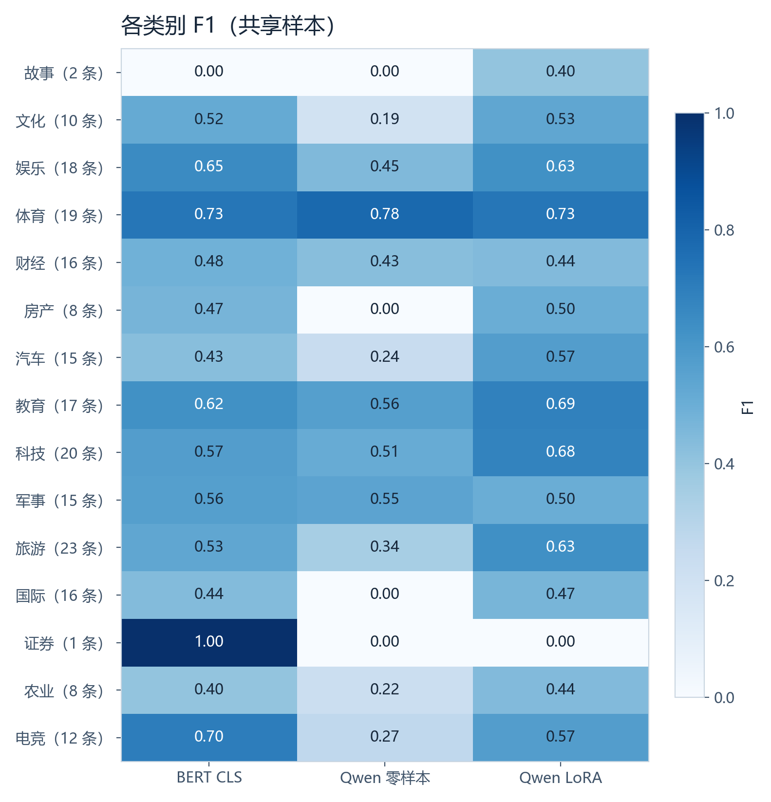
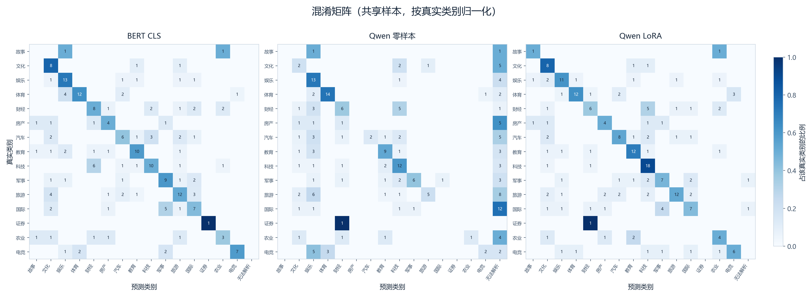

# TNEWS 中文新闻标题分类评估

2026-11-10 · NVIDIA GeForce RTX 4060 Laptop GPU

## 评估设置

从 TNEWS 验证集按项目默认设置随机抽取 200 条（seed=42）。BERT CLS、Qwen2-0.5B-Instruct 零样本、加载已有 LoRA 权重后的 Qwen 使用同一批标题。BERT 另外评估全部 10,000 条验证样本。测试集带有效标签的样本为 0/10,000，本次指标均来自验证集。

BERT 使用 已有的 CLS 微调权重 best_cls.pt，Qwen LoRA 使用项目自带的 outputs/sft_adapter。本次直接评估已有权重。Qwen 沿用项目的提示词、贪心解码和类别名子串解析。准确率将无法解析的输出计作错误，宏平均 F1 对 15 个真实类别等权平均。

## 同一批样本上的结果

| 模型 | 评估条数 | 正确条数 | 准确率 | 宏平均 F1 | 无法解析 |
|---|---:|---:|---:|---:|---:|
| BERT CLS | 200 | 110 | 55.0% | 0.5405 | 0 |
| Qwen 零样本 | 200 | 72 | 36.0% | 0.3022 | 58 |
| Qwen LoRA | 200 | 116 | 58.0% | 0.5189 | 2 |

- **LoRA 与零样本对比。** 准确率变化 +22.0 个百分点，宏平均 F1 变化 +0.2168。同一标题逐条配对后，54 条由错变对，10 条由对变错。
- **输出可解析性。** 零样本有 58 条无法解析（29.0%）。LoRA 的不可解析输出为 2 条。零样本的常见不可解析输出包括「交通」11 次、「外交」7 次、「房地产」6 次。只看各自可解析的样本时，零样本与 LoRA 的准确率分别为 50.7% 和 58.6%。
- **BERT 与 LoRA 对比。** BERT 相对 LoRA 的准确率差为 -3.0 个百分点，宏平均 F1 差为 +0.0215。三组使用已有权重，训练方式及训练数据规模不同，差值反映本次配置的表现。

## 类别表现与错误

共享样本中，样本量较多的类别有旅游 23 条、科技 20 条、体育 19 条，较少的有证券 1 条、故事 2 条、房产 8 条。证券类只有 1 条，BERT 和 LoRA 在该类的 F1 分别为 1.00 和 0.00。若只看其余 14 类的平均 F1，BERT 为 0.5077，LoRA 为 0.5560。这项敏感性检查说明，共享样本上的宏平均 F1 排名受证券类样本量影响。LoRA 相比零样本在房产（0.00 → 0.50）和国际（0.00 → 0.47）的 F1 改善明显。

矩阵按真实类别归一化着色，格内数字为原始条数。常见的错分方向如下。

- **BERT CLS**　「科技 → 财经」6 条、「国际 → 军事」5 条、「体育 → 娱乐」4 条。
- **Qwen 零样本**　「旅游 → 娱乐」6 条、「财经 → 科技」5 条、「电竞 → 娱乐」5 条。
- **Qwen LoRA**　「财经 → 科技」5 条、「国际 → 军事」4 条、「体育 → 电竞」3 条。

## BERT 全量验证

共正确 5,533/10,000 条，准确率 **55.33%**，宏平均 F1 **0.5456**。

- F1 最高的三个类别为体育 0.71（767 条）、汽车 0.66（791 条）、电竞 0.63（659 条）。
- F1 最低的三个类别为证券 0.43（45 条）、国际 0.44（905 条）、故事 0.47（215 条）。
- 最常见的三组错分为「国际 → 军事」266 条、「科技 → 财经」247 条、「财经 → 科技」148 条。

## 指标明细

- [指标明细](metrics.json) 包含准确率、宏平均 F1、各类 precision／recall／F1、支持数、混淆计数和两组 Qwen 的配对结果。
